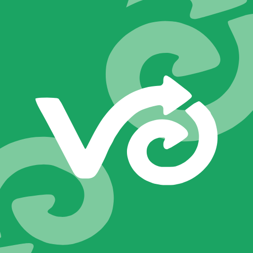
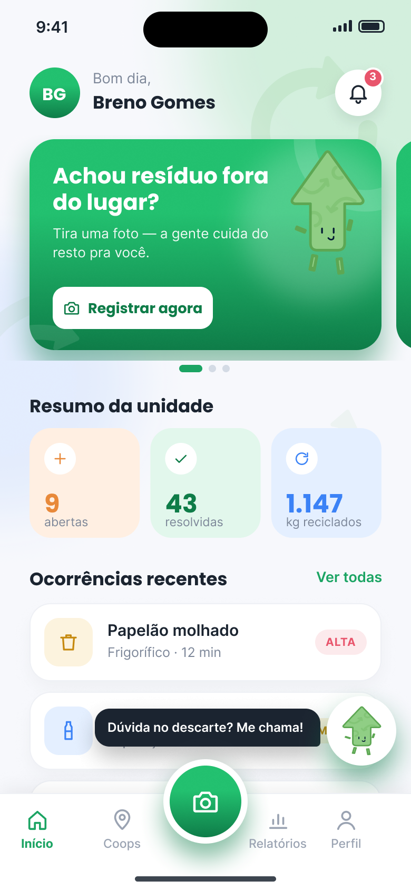
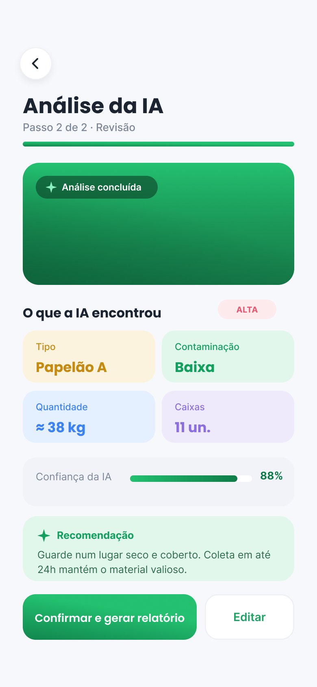
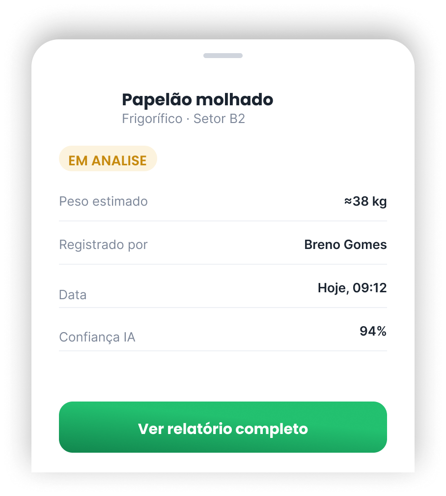
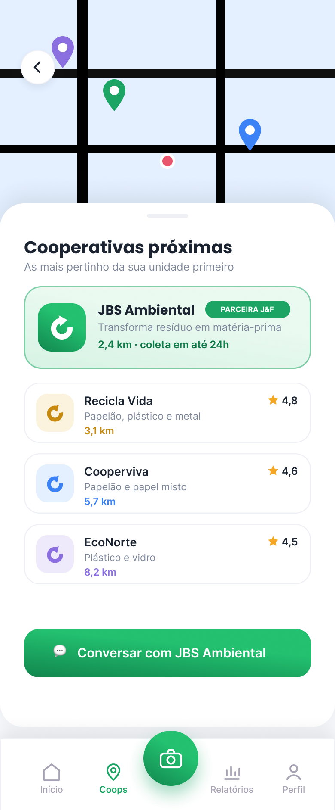
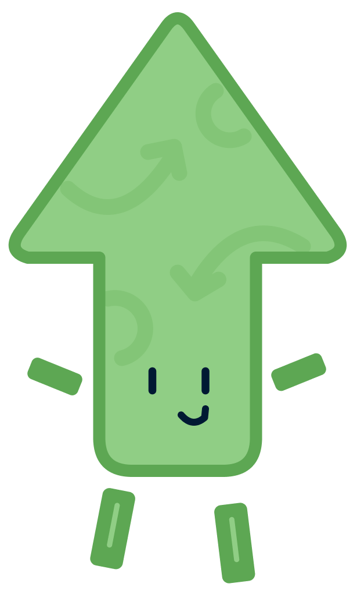
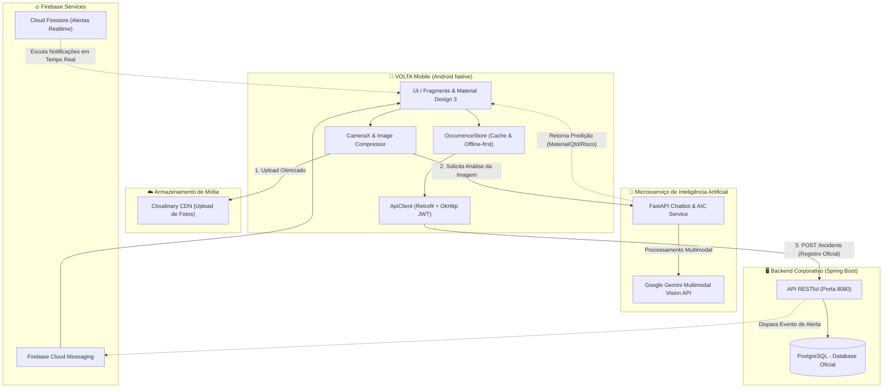

<p align="center">
  
</p>

<h1 align="center">VOLTA Mobile — Gestão Inteligente & Triagem de Resíduos</h1>

<p align="center">
  <strong>Aplicativo Android Nativo para monitoramento, triagem automatizada com Inteligência Artificial e rastreabilidade de resíduos industriais em conformidade com o PGRS e padrões ESG.</strong>
</p>

<p align="center">
  
  
  
  
  
  
  
</p>

---

## 📱 Visão Geral da Interface

Conheça as principais telas do aplicativo, projetadas com foco em **agilidade no chão de fábrica**, **alta legibilidade** e **feedback em tempo real**:

| 📊 Dashboard Principal | 🤖 Triagem por IA (AIC) | 📋 Detalhe da Ocorrência |
| :---: | :---: | :---: |
|  |  |  |

<br/>

| 🤝 Rede de Cooperativas Parceiras | 🦊 Mascote & Engajamento Operacional |
| :---: | :---: |
|  |  |

---

## 🎯 Sobre o VOLTA Mobile

O **VOLTA Mobile** é a ponta operacional do ecossistema VOLTA, concebido para transformar a rotina de gestão de resíduos sólidos em empresas, parques industriais e centros logísticos.

Tradicionalmente, descartes incorretos e acúmulos de materiais são registrados em planilhas manuais ou formulários demorados, gerando perda de dados, riscos de autuação ambiental e baixa taxa de reciclagem. O VOLTA resolve esse gargalo através de:

1. **Registro Instantâneo com Câmera**: Em menos de 10 segundos, o colaborador registra fotos do resíduo ou do ponto de descarte.
2. **Classificação Automatizada por IA**: Visão computacional identifica tipo de material, nível de contaminação e peso estimado.
3. **Logística Reversa & Cooperativas**: Roteamento direto dos materiais para cooperativas cadastradas e centros de reciclagem certificados.
4. **Governança ESG & PGRS**: Cada ocorrência gera métricas auditáveis em conformidade com o Plano de Gerenciamento de Resíduos Sólidos.

---

## ✨ Funcionalidades Principais

### 1. 🔐 Autenticação Segura & Perfis
- Login corporativo com credenciais criptografadas via JWT Bearer Token.
- Suporte a múltiplos perfis operacionais (Operador de Campo, Gestor Ambiental, Administrador).
- Sessão persistente com interceptação automática de tokens via `TokenManager` e `ApiClient`.

### 2. 📊 Dashboard Operacional (Home)
- Indicadores em tempo real de sustentabilidade:
  - ⚖️ **Total de Kg Reciclados** acumulados no mês.
  - ⚠️ **Ocorrências em Aberto** aguardando triagem ou coleta.
  - ✅ **Ocorrências Concluídas** com destinação ambiental comprovada.
- Lista rápida com as últimas ocorrências registradas com badges de prioridade (`LOW`, `MEDIUM`, `HIGH`) e status.
- Estados de carregamento modernos utilizando **Shimmer Skeleton Effect** (sem spinners genéricos).

### 3. 📸 Captura com Câmera & Upload em Nuvem
- Integração nativa de alta performance via **Android CameraX** e galeria.
- Compactação inteligente de imagens para economia de pacote de dados móveis no chão de fábrica.
- Upload seguro na nuvem com geração de URLs otimizadas via CDN Cloudinary.

### 4. 🧠 Motor de IA — Algoritmo Inteligente de Compatibilidade (AIC)
- Análise de imagens em tempo real integrando microsserviço Python FastAPI e modelos multimodais de visão computacional:
  - **Identificação do Resíduo**: Plástico, Papel/Papelão, Vidro, Metal, Orgânico, Eletrônico ou Perigoso.
  - **Grau de Contaminação**: Identificação de mistura com resíduos orgânicos, óleos ou substâncias químicas.
  - **Cálculo de Urgência**: Determinação da prioridade de coleta com base no risco operacional.
  - **Estimativa de Massa**: Projeção volumétrica aproximada em quilogramas (kg).
- Possibilidade de revisão e reclassificação humana assistida via Bottom Sheet interativo.

### 5. 🔍 Gestão, Busca & Filtros Avançados
- Filtragem dinâmica por período, status (`PENDING`, `APPROVED`, `RESOLVED`, `CLOSED`), setor/área da fábrica e categoria do material.
- Tela detalhada com histórico completo da ocorrência, linha do tempo e observações técnicas.

### 6. 🤝 Conexão com Cooperativas de Reciclagem
- Mapeamento de parceiros certificados para descarte correto e valorização da economia circular.
- Informações de contato, rotas de coleta e tipos de resíduos aceitos por cada cooperativa.

### 7. 🔔 Notificações em Tempo Real
- Alertas imediatos via **Firebase Cloud Messaging (FCM)** e sincronização via **Cloud Firestore**.
- Notificação ao colaborador quando sua ocorrência for validada, coletada ou resolvida pela equipe de sustentabilidade.

---

## 🏛️ Arquitetura do Sistema

O ecossistema VOLTA adota uma arquitetura em microsserviços desacoplada e resiliente:



---

## 💻 Stack Tecnológica

| Componente | Tecnologia | Finalidade |
| :--- | :--- | :--- |
| **Linguagem** | Java 11 / 17 | Código estável, robusto e fortemente tipado |
| **Arquitetura** | Layered / Clean MVVM-inspired | Separação estrita de UI, Domínio, Dados e Rede |
| **Build System** | Gradle 9.0 com Version Catalogs (`libs.versions.toml`) | Gerenciamento centralizado e declarativo de dependências |
| **Interface / UI** | Android Material Components 3, ViewBinding | Componentes modernos, acessíveis e seguros contra null-pointers |
| **Câmera** | AndroidX CameraX (Core, Camera2, Lifecycle, View) | Controle de hardware moderno e responsivo |
| **Comunicação HTTP** | Retrofit 2.11 + OkHttp 4.12 + Gson | Requisições assíncronas com tratamento de headers e DTOs |
| **Carregamento de Imagem** | Glide 4 + Cloudinary SDK | Cache em memória e em disco, placeholders e transformações |
| **Notificações** | Firebase Messaging (FCM) + Cloud Firestore | Mensageria instantânea e push notifications em segundo plano |
| **Efeitos Visuais** | Facebook Shimmer Effect & Lottie | Feedback visual rico e skeletons durante requisições assíncronas |
| **Testes** | JUnit 4, AndroidX Test, Mockito | Cobertura de regras de negócio, parsers de IA e filtros de dados |

---

## 📂 Estrutura de Diretórios

```plaintext
Volta/
├── app/
│   ├── src/
│   │   ├── main/
│   │   │   ├── java/com/aula/volta/
│   │   │   │   ├── data/
│   │   │   │   │   ├── api/             # Interfaces Retrofit, interceptors e clients
│   │   │   │   │   ├── filter/          # Algoritmos de filtragem e busca de ocorrências
│   │   │   │   │   ├── local/           # OccurrenceStore e gerenciamento de estado local
│   │   │   │   │   ├── model/           # Entidades de domínio, DTOs e payloads de IA
│   │   │   │   │   ├── notification/    # Repositório de notificações Firestore
│   │   │   │   │   ├── report/          # Calculadoras de métricas ESG e relatórios PGRS
│   │   │   │   │   └── sync/            # Gerenciamento de sincronização
│   │   │   │   ├── ui/
│   │   │   │   │   ├── analysis/        # Fluxo de captura e análise de resíduo por IA
│   │   │   │   │   ├── auth/            # Telas de login e onboarding
│   │   │   │   │   ├── detail/          # Telas de detalhe e sheets de reclassificação
│   │   │   │   │   ├── occurrences/     # Listagem e filtros de ocorrências
│   │   │   │   │   └── profile/         # Perfil do colaborador e configurações
│   │   │   │   ├── HomeFragment.java    # Controlador principal da Dashboard
│   │   │   │   └── MainActivity.java    # Container principal com BottomNavigation
│   │   │   └── res/
│   │   │       ├── drawable/            # Ícones vetoriais, fundos e gradientes oficiais
│   │   │       ├── layout/              # Telas em XML (Material 3 e Skeletons)
│   │   │       └── values/              # Cores, dimensões, temas e strings localizadas
│   │   └── test/                        # Suíte de testes unitários automatizados
├── docs/
│   ├── brand_assets/                    # Ícones de marca e vetores oficiais
│   └── screenshots/                     # Capturas de tela para documentação
├── build.gradle.kts                     # Configuração raiz de build
└── gradle/libs.versions.toml            # Version Catalog de dependências
```

---

## 🚀 Como Executar o Projeto

### Pré-requisitos
- **Android Studio** (versão Ladybug 2024.2+ ou Hedgehog/Iguana).
- **JDK 17** configurado no Android Studio (`Settings > Build, Execution, Deployment > Build Tools > Gradle`).
- Dispositivo físico Android (Android 9.0+) ou Emulador configurado com Google Play Services (API 28 a 36).

### Passo a Passo

1. **Clonar o Repositório:**
   ```bash
   git clone https://github.com/seu-usuario/Volta.git
   cd Volta
   ```

2. **Configurar Credenciais do Firebase:**
   - Certifique-se de que o arquivo `google-services.json` válido do projeto VOLTA esteja presente na pasta `app/`:
     ```plaintext
     app/google-services.json
     ```

3. **Sincronizar Dependências do Gradle:**
   Abra o projeto no Android Studio e aguarde a indexação e o Gradle Sync finalizarem, ou execute no terminal:
   ```bash
   ./gradlew build
   ```

4. **Compilar e Gerar APK de Debug:**
   ```bash
   ./gradlew assembleDebug
   ```
   O APK compilado estará disponível em:
   ```plaintext
   app/build/outputs/apk/debug/app-debug.apk
   ```

5. **Instalar Diretamente em Dispositivo Conectado (ADB):**
   ```bash
   ./gradlew installDebug
   ```

---

## 🧪 Testes Automatizados

O projeto conta com uma suíte de testes unitários para garantir a consistência das regras de filtragem, contratos de API e decodificação das respostas da IA:

```bash
./gradlew testDebugUnitTest
```

Para verificar o relatório detalhado de testes em HTML:
```plaintext
app/build/reports/tests/testDebugUnitTest/index.html
```

---

## 🎨 Design System & Cores da Marca

A paleta de cores do VOLTA foi desenvolvida para transmitir responsabilidade ambiental, tecnologia e alta clareza operacional:

| Nome do Tom | Código HEX | Aplicação |
| :--- | :---: | :--- |
| **Volta Emerald Primary** | `#!#10B981` | Botões principais, indicadores de sucesso, destaques da marca |
| **Volta Forest Dark** | `#!#065F46` | Barra de status, cabeçalhos escuros, gradientes de destaque |
| **Slate Dark (Superfície)**| `#!#0F172A` | Cards escuros, textos de títulos de alta hierarquia |
| **Warning / Pendente** | `#!#F59E0B` | Badges de ocorrências em análise ou pendentes de coleta |
| **Danger / Crítico** | `#!#EF4444` | Resíduos perigosos, alertas de contaminação e erros |
| **Background Neutro** | `#!#F8FAFC` | Telas de fundo e cartões com leve contraste visual |

---

## 🛡️ Segurança & Conformidade

- **Criptografia em Trânsito**: Todas as chamadas para a API Spring Boot, Cloudinary e microsserviço de IA são realizadas estritamente sobre HTTPS/TLS.
- **Proteção de Secrets**: Tokens JWT, chaves de autenticação e credenciais são armazenados de forma isolada, nunca expostos no código-fonte aberto.
- **Regras de Segurança do Firebase**: As permissões do Cloud Firestore (`firestore.rules`) garantem acesso granular com base na autenticação do operador.

---

## 👥 Equipe & Contribuição

Desenvolvido com foco em excelência de engenharia e sustentabilidade pelo time do **Projeto VOLTA**.

Para contribuir:
1. Crie uma branch para sua funcionalidade: `git checkout -b feature/minha-feature`
2. Garanta que os testes continuam passando: `./gradlew testDebugUnitTest`
3. Envie suas alterações: `git commit -m "feat: descrição da melhoria"`
4. Abra um Pull Request detalhado para revisão técnica.

---

<p align="center">
  <strong>VOLTA &copy; 2026 — Rastreabilidade, Tecnologia e Circularidade para um Planeta Sustentável.</strong>
</p>
